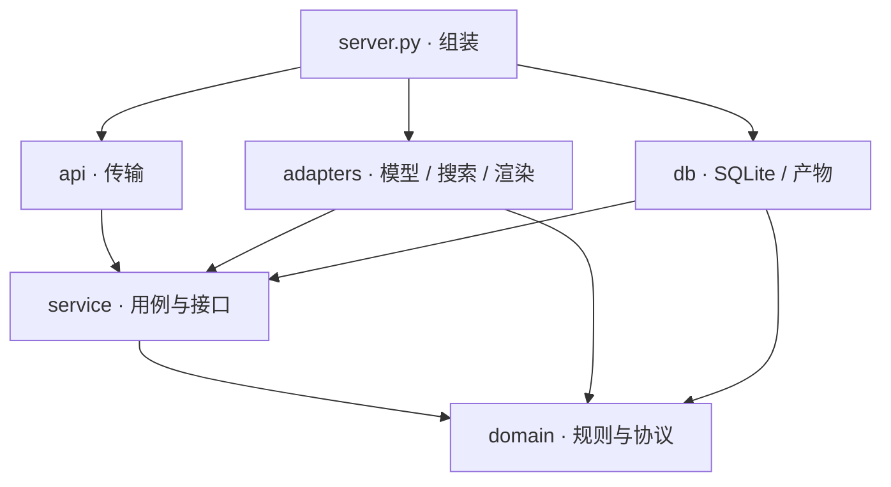

# Edu-Agent 学习教练

面向 K12 的学习教练：一个主 agent 调度四个子 agent（核对、画图、出题、笔记），需要查资料时主 agent 自己写搜索词，由程序去搜，会讲解，会出小题检查是否真的学会，答错时先找原因，学完后经学习者同意整理成笔记。模型部署在 Azure AI Foundry，基于 Microsoft Agent Framework，演示网页部署在 Hugging Face Space。

核心原则是**模型提出，程序决定**：模型负责理解和生成；判分、权限、执行顺序、写入数据这些必须确定的事由程序完成，每个模型输出都要先通过 schema 校验才能使用。

产品设计见 [PRD](docs/product/Edu-agent-PRD-v3.md)，架构见 [架构说明](docs/design/architecture.md)。

## 目录

- [快速开始](#快速开始)
- [配置](#配置)
- [项目结构](#项目结构)
- [架构](#架构)
- [测试与评测](#测试与评测)
- [部署](#部署)
- [已知限制](#已知限制)
- [文档](#文档)

## 快速开始

前置：Python 3.13+、[uv](https://docs.astral.sh/uv/)、[Azure CLI](https://learn.microsoft.com/cli/azure/install-azure-cli)，并已 `az login`。

```bash
cp agent/.env.example agent/.env   # 填 FOUNDRY_PROJECT_ENDPOINT 和 AZURE_AI_MODEL_DEPLOYMENT_NAME
```

| 入口 | 启动方式 | 地址 |
| --- | --- | --- |
| 演示网页（与 Space 同一页面） | 双击 [`space/本地试用.command`](space/本地试用.command) | http://localhost:8000 |
| Responses API 服务 | `uv run --project agent --locked python agent/main.py` | http://localhost:8088 |
| 命令行对话 | `uv run --project agent --locked python agent/demo.py` | 终端 |

`本地试用.command` 第一次运行会建好 `space/.venv` 并安装 [`space/requirements.txt`](space/requirements.txt)；`uv run` 按 [`agent/uv.lock`](agent/uv.lock) 安装依赖。

## 配置

所有入口都读取 `agent/.env`（不进 git），模板和全部可选项见 [`agent/.env.example`](agent/.env.example)。认证使用 `DefaultAzureCredential`，不需要 API key。

| 变量 | 必填 | 说明 |
| --- | --- | --- |
| `FOUNDRY_PROJECT_ENDPOINT` | 是 | Foundry 项目地址，到 `/api/projects/<项目名>` 为止 |
| `AZURE_AI_MODEL_DEPLOYMENT_NAME` | 是 | 默认模型部署名 |
| `LEARNING_COACH_MODEL_<角色>` | | 给单个 agent 指定模型，角色为 `COORDINATOR`、`VERIFIER`、`NOTES`、`VISUALIZER`、`QUIZZER` |
| `LEARNING_COACH_IMAGE_BACKEND` | | 配图后端，`flux`（默认，部署名 `flux-2-pro`）或 `pollinations` |
| `TAVILY_API_KEY` | | 检索用 Tavily；不填时用 Wikipedia |
| `LEARNING_COACH_DATA_DIR` | | 学习记录和互动图的存放目录 |
| `LEARNING_COACH_MEMORY_STORE` | | Foundry Memory 语义层；不设 = 纯 SQLite。store 需先用 [`scripts/setup-memory.sh`](scripts/setup-memory.sh) 创建，失败自动降级 |
| `LEARNING_COACH_MEMORY_SEARCH_MAX` | | 语义检索条数，默认 6 |
| `LEARNING_COACH_MEMORY_TIMEOUT` | | 语义层调用超时秒数，默认 5 |
| `LEARNING_COACH_DEMO_MODE` | | 设为 `1` 时跳过首次问答，学段取 `LEARNING_COACH_DEMO_STAGE` |
| `DEMO_ACCESS_KEY` | | 演示页邀请码，访问链接需带 `?key=` |
| `DEMO_MAX_TURNS_PER_DAY` / `DEMO_MAX_IMAGES_PER_DAY` | | 演示页每日上限，默认 150 / 20 |

当前模型分工：核对（查证和审图）、画图用 `gpt-6-luna`，主 agent（含写搜索词）、出题、笔记用 `gpt-5.4-mini`，配图 `flux-2-pro`。三处入口要一致：本地看 `agent/.env`，托管看 `azure.yaml`，Space 看它的 Variables。

## 项目结构

```text
.
├── agent/                  Foundry 托管 agent，azd 部署此目录
│   ├── main.py             Responses API 入口
│   ├── demo.py             命令行对话
│   ├── learning_coach/     应用代码（分层见「架构」）
│   ├── prompts/            主 agent 与 4 个子 agent 的提示词
│   ├── response.schema.json
│   └── pyproject.toml, uv.lock, Dockerfile, .env.example
├── space/                  Hugging Face Space 演示网页（Gradio）
├── tests/                  单元与集成测试
├── evals/                  评测用例与打分脚本
├── scripts/                打包 Space、离线校验、修复权限
├── docs/                   产品、设计、报告与历史文档
└── azure.yaml              azd 部署配置
```

常用入口：

| 想看什么 | 文件 |
| --- | --- |
| 依赖组装（唯一创建模型客户端和数据库的地方） | [`agent/learning_coach/server.py`](agent/learning_coach/server.py) |
| 单轮教学流程 | [`agent/learning_coach/service/pipeline.py`](agent/learning_coach/service/pipeline.py) |
| 检索与查证 | [`agent/learning_coach/service/research.py`](agent/learning_coach/service/research.py) |
| 工具准入与测验规则 | [`agent/learning_coach/domain/routing.py`](agent/learning_coach/domain/routing.py) |
| 首次问答与记录同意 | [`agent/learning_coach/domain/onboarding.py`](agent/learning_coach/domain/onboarding.py) |
| 学习记录（SQLite） | [`agent/learning_coach/db/memory.py`](agent/learning_coach/db/memory.py) |
| 模型调用与重试 | [`agent/learning_coach/adapters/runner.py`](agent/learning_coach/adapters/runner.py) |
| 主 agent 提示词 | [`agent/prompts/instructions.md`](agent/prompts/instructions.md) |
| 子 agent 提示词 | [`agent/prompts/agents/`](agent/prompts/agents) |
| 对外响应协议 | [`agent/response.schema.json`](agent/response.schema.json) |
| 演示网页 | [`space/app.py`](space/app.py) |

## 架构

一轮对话的流程：

```text
学习者 → coordinator（决定）─┬─ 直接回答 ──────────────────────────┐
                            └─ 调用子 agent：                      │
                                 程序搜索 + verifier    检索、查证  │
                                 quizzer                出题、判分  │
                                 notes / visualizer     笔记、画图  │
                                                                   ↓
                         coordinator（回复）→ schema 校验 → 四字段 JSON
```

`learning_coach/` 按依赖方向分层，箭头表示「依赖于」：



[`service/ports.py`](agent/learning_coach/service/ports.py) 定义接口，`db/` 和 `adapters/` 实现接口，换存储、搜索或生图后端只需在 `server.py` 注入新实现。模块清单与替换说明见 [架构说明](docs/design/architecture.md)。

主要设计取舍：

- **协议校验**：对外只有 `schema_version / intent / message / next_step` 四个字段。每个角色的输出都过 schema 校验，失败最多重试一次，仍失败则用固定兜底文案。
- **意图分类**：每条消息归入 A–G 七类（概念、解题、练习、规划、闲聊情绪、越界、不明确），并标记是否为隐式意图。
- **信源查证**：引用必须来自实际检索到的记录。证据按 verified / likely / disputed / unavailable 分级，等级决定回复措辞和能否出图。
- **出题状态机**：一次只出一道题，答案只存在程序状态里，不进入模型上下文。
- **学习记录需同意**：首次见面询问学段并征求同意后才保存，可随时关闭或删除。
- **教学图**：visualizer 输出声明式场景，程序校验、审阅后用固定版本 SVG.js 绘制，模型不能提交可执行代码。

## 测试与评测

```bash
uv run --project agent --locked --group dev python -m unittest discover -s tests
```

测试用 fake 模型覆盖真实 SDK 接口，不调用真实模型；交互图测试需要 Node，没装时自动跳过。共 321 个测试；需要完整 SDK 环境或 Node 的测试，缺少时自动跳过。

- 评测用例：[`evals/cases.jsonl`](evals/cases.jsonl)，打分脚本 [`evals/score.py`](evals/score.py)
- 离线校验真实响应：[`scripts/validate_responses.py`](scripts/validate_responses.py)

## 部署

**Foundry 托管 agent**（配置见 [`azure.yaml`](azure.yaml)）：

```bash
azd deploy
azd ai agent invoke "请围绕一元一次方程考考我，一次只出一道题。"
```

**Hugging Face Space**：运行 `python scripts/build_space.py` 生成 `build/space/`，把其中的文件上传到 Space。Space 的环境变量与 `agent/.env` 相同，在 Space 设置里填写。若模型调用返回 403，运行 [`scripts/fix-permissions.sh`](scripts/fix-permissions.sh) 补回服务主体的权限。

## 已知限制

- 没有流式输出，每轮返回一段完整文本。
- Foundry 托管入口里的互动图链接打不开：链接指向 `localhost:8088`，网关不转发自定义路由，需要改用 blob 存储。演示网页里互动图正常显示。
- 确定性学习记录以 SQLite 为准；托管入口的跨会话连续性由 Foundry Memory 语义层提供（启用 `LEARNING_COACH_MEMORY_STORE` 后按平台用户身份分 scope）。
- 意图分类准确率和教学效果还没有量化评测。

完整的缺口和计划见 [PRD 第六部分](docs/product/Edu-agent-PRD-v3.md)。

## 文档

| 文档 | 内容 |
| --- | --- |
| [产品需求文档](docs/product/Edu-agent-PRD-v3.md) | 学习科学依据、产品原则、核心机制、验证计划 |
| [架构说明](docs/design/architecture.md) | 依赖分层、模块清单、如何替换实现 |
| [多 agent 实现](docs/design/multi-agent.md) | 各角色职责、执行顺序、工具准入、存储与可视化 |
| [提示词设计](docs/design/prompt-design.md) | 主 agent 提示词结构与取舍 |
| [提示词规范](docs/design/prompt-house-rules.md) | 所有提示词必须遵守的八条规则 |
| [进度分析](docs/reports/foundry-demo-进度分析.md) | 2026-10-16 代码与 PRD 的对照 |
| [历史文档](docs/history) | v1.5 验收计划、提示词基线、输出核查、旧前端交接说明 |
