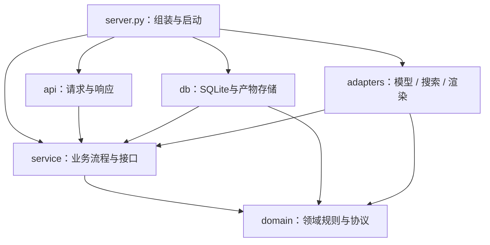

# edu-agent 产品架构

当前代码已从单 Agent Prompt 扩展为五角色、进程内按需协作的学习教练。对外 `schema_version` 仍为 `"1.0"`；角色内部协议和存储不属于面向客户端的响应字段。实现细节、限制与本地验证见 [`multi-agent.md`](multi-agent.md)。本文描述代码状态，不代表已部署或完成真实模型验收。

## 代码依赖与组装边界

目录按职责划分；箭头表示源码依赖，不表示执行顺序。接口由使用它的 Service 定义，DB 和外部适配器实现这些接口；Server 选择具体实现并注入。



```text
learning_coach/
├── server.py                 # 唯一的生产依赖组装入口
├── api/
│   ├── http.py               # Responses 端点、产物读取路由
│   └── host.py               # SDK 消息与应用输入/输出转换
├── service/
│   ├── pipeline.py           # 单轮教学用例编排
│   ├── research.py           # 检索与查证用例
│   ├── visual_generation.py  # 教学图起草、审阅与重绘
│   ├── ports.py              # Service 所需接口与 StorageError
│   └── execution.py          # 调用预算与阶段失败约定
├── domain/
│   ├── routing.py            # 工具准入、测验与出图恢复规则
│   ├── onboarding.py         # 首次见面问答与记录同意
│   ├── context.py            # 各角色的上下文与 token 预算
│   ├── mastery.py            # 掌握度计算；没有 SQL
│   ├── contracts.py          # 回复协议、选择题评分
│   ├── note_contracts.py     # 笔记数据协议
│   ├── visual_contracts.py   # 图示数据协议
│   ├── scene_contracts.py    # 分步场景协议与排版检查
│   ├── visual_quality.py     # 图示审阅协议
│   ├── teaching_visuals.py   # 把图示转成给 coordinator 的文字说明
│   └── research_contracts.py # 来源证据协议与校验
├── db/
│   ├── memory.py             # SQLite 笔记、事务、幂等
│   ├── artifacts.py          # 产物文件、索引、过期与归属
│   └── storage_errors.py     # 数据库异常转为 Service 错误
└── adapters/
    ├── runner.py             # 模型 SDK 实现
    ├── search_providers.py   # Wikipedia / Tavily 实现
    ├── illustrate.py         # AI 生图实现
    ├── scenes.py             # 分步场景渲染（scene_assets/、vendor/ 为前端资源）
    └── visuals.py            # HTML / SVG 渲染；不读写存储
```

### 一次调用如何经过各层

`main.py` 调用 Server 组装依赖并启动 HTTP 接入；`api/host.py` 转换请求并调用 `service/pipeline.py`。Service 使用 Domain 规则和自己定义的接口；实际数据库和模型调用由注入的实现完成。Server 也供 `space/app.py` 使用，两个入口保留各自的数据目录、公开地址和 native JSON 默认值。命令行脚本 `demo.py` 同样直接调用 `learning_coach.server.create_pipeline`。

### 更换实现时修改哪里

- 换 SQLite：在 db 实现 `service.ports.LearningMemory`，由 Server 注入。Service 只捕获 StorageError，不依赖 sqlite3.Error；数据库事务先回滚再翻译异常。
- 换搜索或生图：实现 SearchProvider / ImageGenerator，由 `server.create_pipeline(search_provider=..., image_generator=...)` 注入。ResearchService 必须显式传 provider，不自行选择供应商。
- 换渲染：实现 VisualRenderer 并注入 ArtifactStore。产物存储不导入具体渲染器；渲染也不创建数据库。
- 改教学规则：修改 domain；改工作流：修改 service；改传输方式：修改 api。协议使用 Python Protocol 表达，测试替身无需继承具体实现。

组装根集中创建长期依赖，不限制业务层创建请求、结果等普通值对象。新增导入边界测试防止 domain/service 反向依赖 api/db/adapters/server；导入 Service 不加载模型 SDK、数据库或渲染模块。

本次同步更新仓库内导入与测试，不保留旧的平铺模块。项目外若直接导入旧 `learning_coach.memory` 等内部路径，需要改用新目录；HTTP 公开协议、数据文件位置、数据库格式和既有评分/出图规则不变。当前依赖方向以本节为准。

## 产品目标

服务所有有学习需求的人，包括学龄前儿童、不同阶段的学生、工作技能学习者和兴趣学习者。教学效果以可观察的独立应用为依据，根据目标、相关基础、参与方式及实际表现调整方法。

画像按当前任务需要逐步获取，不要求先完成长问卷才开始帮助。学龄前优先短活动、实物操作和陪伴者协助；课程学习侧重概念与迁移；工作学习侧重实际任务和可验证结果。群体只是初始参考，不能用年龄、身份或单次表达推定能力。陪伴者代答不作为孩子掌握知识的证据。

## 当前系统

```text
学习者 / 陪伴者
      │
      ▼
ResponsesHostServer → Learning Coach BaseAgent → 会话与控制命令
                                           │
                                    coordinator decide
                                           │
                       ┌───────────────────┴──────────────────────┐
                       ▼                                          ▼
                  mode=answer                                mode=tools
             最终答复与任务控制                         工具理由 / 当前原文证据检查
                       │                                          │
                  本地校验                               按需检索或测验评分 / 出题
                       │                              有真实资料才调用 verifier
                       │                                          │
                       │                             notes + visualizer 独立并发
                       │                                          │
                       │                           coordinator respond 汇总工具终态
                       │                                          │
                       │                                 最终校验 → 提交笔记 / 产物
                       └───────────────────┬──────────────────────┘
                                           ▼
                                  对外发送完整合法 JSON
```

首轮 `phase=decide` 优先直接完成答复；`mode=answer` 通过校验后即可返回，不再让普通问题固定经历 `plan → respond`。只有必要能力才使用 `mode=tools` 返回计划。E/F/G、明确结束或暂停不启动工作能力；工具无必要时澄清或直接回答。当前程序选择题的作答必须经过评分和进度管理。

已有待答题且答案能明确评分、无暂停/结束/stop 时，结构合法但选错的路由会由程序恢复为最小 quiz continue，而非立即返回 G；不额外调用 decide，不检索或画图。主题、题数和难度取已存状态；身份与可用的本轮计划保守合并：陪伴者报告优先，双方均 learner 才保留 learner，未知不升级。正常评分也统一计划、quiz、证据及 notes 的身份。记忆开启时可记录可信答题证据；无活动题或歧义回答不强制恢复，正常有效续答不重建路由。stop-only 工具计划也能清理状态，无需请求其他能力。

工具请求通过 `plan.tool_reasons` 提供枚举 `code` 与当前消息的 `evidence_quote`，程序检查请求一致性、原文出处及权限状态；理由是否在语义上成立仍由行为验收判断。完整准入表见 [`multi-agent.md`](multi-agent.md#工具选择依据)。检索只用于查找、时效、核查或知识缺口；测验用于明确练习、接受检查或续答；笔记需 opt-in 及本轮学习信息；可视化需符合四类模板。图示不自动触发检索，verifier 仅在取得真实检索材料后运行。

## 职责和程序边界

| 角色 / 程序 | 已实现责任 | 限制 |
|---|---|---|
| `coordinator` | 首次决定直接回答或必要工具链，处理意图、画像、任务控制和最终回复。 | 教学语义、工具必要性与分类准确率仍需真实模型验收。 |
| `researcher` + 搜索程序 | 生成 2–4 个查询；访问 Wikipedia 或已配置的 Tavily。 | 固定 API 域，有限查询和响应；失败明确不可用。 |
| `verifier` + 证据检查 | 检查来源 ID、连续原文摘录和支持关系；输出证据等级。 | 双源门槛不能替代语义核查；模型判断可能出错。 |
| `notes` + SQLite | 用户开启后记录画像、概念关系、错因、复习事项和答题证据。 | 同一托管会话隔离；没有跨会话账号关联。 |
| `visualizer` + 模板 | 对照、步骤、闪卡、一次函数四类可交互 HTML。 | 无任意代码生成；产物 24 小时能力链接，部署路由待验。 |
| 本地校验层 | JSON/Schema 错误在预算允许时最多格式重试一次；明确待答选项的路由冲突可程序恢复，其他致命错误按原有兜底处理。 | Schema、原文匹配和短引文过滤不保证事实、工具必要性或教学效果。 |

默认检索无需密钥，Wikipedia 不同语言版本算同一个发布方。`verified` 必须有至少两个独立发布方的页面节选支持并通过程序检查；单一维基来源、仅搜索摘要、同域及复制内容最多为 `likely`。有效反证标为 `disputed`，检索或核查不能完成时标为 `unavailable`。不得把模型已有知识补写成外部证据。

笔记采用 JSON 和程序化写入，旧草稿中的 YAML 输出与模型自行加减掌握度不再使用。错误原因未确认时保持未知，不把粗心当作默认解释。模型可以提取证据，掌握度更新由程序控制。

工具路径以可选能力得到结果或明确失败为结束依据，随后汇总、校验、提交；资料不足时说明限制，不盲目补跑所有角色。出题或主流程的致命错误直接进入固定兜底。检索与测验之后，独立 notes 和 visualizer 并发且等待结束；失败可局部降级，不能作为脱离本轮的后台写入。`respond.tool_results` 向主角色提供工具终态；接纳后 `state.last_execution` 保留模式与四能力结果。笔记须实际新增写入才为 `saved`，未新增写入为 `not_written`；图卡须发布成功才为 `published`。

仅路由恢复回合在内部 `last_execution` 标记 `routing_repaired="pending_quiz_answer"`，对外 JSON 不变。引文至少含两个非空白字符，完整引用本就单字的输入除外；这项程序过滤不代替语义验收。

## 对外协议与用户界面

[`response.schema.json`](../../agent/response.schema.json) 定义最终四字段：`schema_version`、`intent`、`message`、`next_step`。`intent` 保留一个 A—G 主标签与 `is_implicit`；不增加 `compound` 字段，不恢复 `log_intent` 工具。

复合需求的待处理任务属于会话状态，不在主意图标签中编码。遇到情绪需求时暂停任务；恢复仍须根据可用上下文和学习者意愿。`mode`、任务控制、工具理由和终态均为内部字段，不加入最终四字段 JSON。工具失败的适当说明可以进入可见回复，原始角色消息、记忆 JSON 与失败尝试不直接展示。

本地演示入口和托管入口使用相同流水线。演示网页是 `space/app.py`（Gradio，本地和 Hugging Face Space 共用），解析完整 JSON 后读取 `message` 和 `next_step`；阶段进度、逐字流式及生产化验收未完成。图片或交互链接在可见文本中表达，结构化元数据留在内部。

托管层仍等最终合法结果完成后整体发送，不提供 SSE 进度提示或逐字答案。正常直答减少一次模型调用，独立能力并发减少串行等待；`agent_stage` 日志记录单次模型调用的角色、阶段、尝试、结果和耗时，不记录正文，也不覆盖整轮或搜索网络耗时。本次没有真实端点延迟测量，不能承诺固定响应秒数。

`LEARNING_COACH_NATIVE_JSON=1` 可启用模型端原生结构化输出；无论是否开启，都执行本地校验。实际部署模型、API 版本与 Schema 子集兼容性须在目标环境中确认。

## 状态、记忆和部署范围

记忆默认关闭，只有明确的 `/memory on` 才允许当前会话读取与记录；`/memory off` 停用并隐藏已有数据，`/forget` 删除当前会话记录和同意状态。

SQLite 以托管层生成的 `AgentSession.session_id` 隔离数据。该标识属于会话，不等于稳定的学习者账号；不同设备或新会话不会自动合并。SQLite 笔记可以保留在本地磁盘，进程内任务状态和身份恢复能力须分别看待。

当前是单机 SQLite、单进程会话状态的实现，没有新增云资源、分布式状态存储、A2A 服务部署或跨会话身份系统。容器需要持久卷才能承诺重启后保留本地文件；多副本部署需要另外解决会话定位、并发状态和共享产物存储。

托管协议的原始响应与历史显式使用内存存储，不采用 SDK 默认的文件存储；服务器也不自动初始化云遥测与原始消息采集。只有用户开启的学习笔记进入 SQLite。进程重启会丢失托管响应历史，持久笔记不等于具备完整会话恢复能力。

可视化使用 `/artifacts/{token}` 的 24 小时能力链接。模板无外联、不执行模型代码；链接本身授予访问能力，不能当作用户鉴权。部署网关是否转发自定义路由、公开基础地址是否正确，仍须实际验证。

## 验证与后续工作

从仓库根运行：

```bash
uv run --project agent --locked --group dev python -m unittest discover -s tests -v
```

离线端到端测试调用真正的编排代码，并注入假的模型与提供方；覆盖单次直答、工具准入和终态、并发能力、专家输出失败、证据降级、笔记开关、会话隔离、事务去重和受控产物。没有使用真实模型得出的分类准确率、核查准确率、教学效果或响应延迟报告。

后续验证应依次覆盖：真实模型 C/D 多轮流程、E 暂停与恢复、学龄前与成人的教学差异、真实检索的限流和不可用、托管会话恢复、公开产物链接及持久存储。已有本地前端的生产化、跨会话画像、分布式部署和远程专家是独立工作，不因角色 Prompt 已存在就算完成。

历史长版 Prompt 保存在 [`prompt-baseline-v1.5.md`](../history/prompt-baseline-v1.5.md)，仅供设计比较，不作为当前多角色架构或运行能力的定义。
