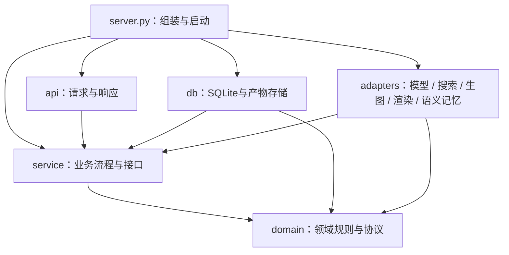

# edu-agent 架构说明

edu-agent 由一个主 agent 和四个子 agent 组成，五个都是 Microsoft Agent Framework 的 `Agent`，在同一个进程里由程序调度。对外只返回四个字段的 JSON，`schema_version` 仍为 `"1.0"`；agent 之间的内部数据和学习记录都不进入对外响应。

本文讲代码怎么分层、五个 agent 各做什么、模型怎么分配、数据放在哪里。每个机制的细节见 [`multi-agent.md`](multi-agent.md)，产品上为什么这样设计见 [PRD](../product/Edu-agent-PRD-v3.md)。本文描述的是代码现状；离线测试通过，不等于真实模型下的分类准确率和教学效果已经验收。

## 代码依赖与组装边界

目录按职责划分；箭头表示源码依赖，不表示执行顺序。接口由使用它的 Service 定义，DB 和外部适配器实现这些接口；Server 选择具体实现并注入。



```text
agent/
├── main.py                   # 托管入口（Foundry Responses 协议）
├── demo.py                   # 命令行对话
├── prompts/
│   ├── instructions.md       # 主 agent
│   └── agents/               # 四个子 agent：source-check（核对）、visual-designer（画图）、
│                             #   quiz-writer（出题）、note-organizer（笔记）
└── learning_coach/
    ├── server.py             # 唯一的组装入口：按角色选模型，选存储、搜索和生图实现
    ├── api/
    │   ├── http.py           # Responses 端点、产物读取路由
    │   └── host.py           # SDK 消息与应用输入/输出转换；读取平台注入的用户编号
    ├── service/
    │   ├── pipeline.py       # 单轮教学用例编排：开场、记录开关、派活、判分、出题、整理笔记
    │   ├── research.py       # 用主 agent 写的搜索词去搜，再交核对 agent 查证
    │   ├── visual_generation.py  # 教学图起草、审阅与重画
    │   ├── ports.py          # Service 所需接口与 StorageError
    │   └── execution.py      # 每轮调用次数上限与阶段失败约定
    ├── domain/
    │   ├── routing.py        # 意图代码、派活准入、执行顺序、测验与出图恢复规则
    │   ├── onboarding.py     # 首次见面问答与记录同意
    │   ├── context.py        # 各 agent 看到的上下文与 token 预算、对话要点
    │   ├── mastery.py        # 掌握程度计算；没有 SQL
    │   ├── contracts.py      # 回复协议、出题协议、选择题判分
    │   ├── note_contracts.py # 笔记数据协议、四类错因
    │   ├── visual_contracts.py   # 图示数据协议
    │   ├── scene_contracts.py    # 分步场景协议与排版检查
    │   ├── visual_quality.py     # 图示审阅协议
    │   ├── teaching_visuals.py   # 把图示转成给主 agent 的文字说明
    │   └── research_contracts.py # 来源证据协议与校验
    ├── db/
    │   ├── memory.py         # SQLite 学习记录、事务、幂等
    │   ├── artifacts.py      # 产物文件、索引、过期与归属
    │   └── storage_errors.py # 数据库异常转为 Service 错误
    └── adapters/
        ├── runner.py         # 调用五个 agent：结构校验、重试、用量记录、阶段回调
        ├── foundry_memory.py # Foundry Memory 语义层（可选），包在 SQLite 外面
        ├── search_providers.py   # Wikipedia / Tavily
        ├── illustrate.py     # FLUX.2-pro 生图
        ├── scenes.py         # 分步场景渲染（scene_assets/、vendor/ 为前端资源）
        └── visuals.py        # HTML / SVG 渲染；不读写存储

space/app.py                  # 演示网页（Gradio，本地和 Hugging Face Space 共用）
scripts/                      # Space 打包、权限修复、Foundry Memory 初始化
```

### 一次调用如何经过各层

三个入口都调用 `server.create_pipeline`，用的是同一条流水线：

- 托管：`agent/main.py` → `api/host.py` → `service/pipeline.py`
- 演示网页：`space/app.py` → `service/pipeline.py`
- 命令行：`agent/demo.py` → `service/pipeline.py`

Service 只用 Domain 规则和自己定义的接口；模型、数据库、搜索和生图由 Server 注入。各入口保留自己的数据目录和公开地址。

### 更换实现时修改哪里

- 换模型：设置 `LEARNING_COACH_MODEL_<角色>`，不用改代码（见下文“模型分工”）。
- 换 SQLite：在 db 实现 `service.ports.LearningMemory`，由 Server 注入。Service 只捕获 StorageError，不依赖 sqlite3.Error；数据库事务先回滚再翻译异常。
- 换搜索或生图：实现 SearchProvider / ImageGenerator，由 `server.create_pipeline(search_provider=..., image_generator=...)` 注入。ResearchService 必须显式传入 provider，不自行选择供应商。
- 换渲染：实现 VisualRenderer 并注入 ArtifactStore。产物存储不导入具体渲染器；渲染也不创建数据库。
- 改教学规则：修改 domain；改工作流：修改 service；改传输方式：修改 api。协议用 Python Protocol 表达，测试替身无需继承具体实现。

导入边界测试防止 domain/service 反向依赖 api/db/adapters/server；导入 Service 不加载模型 SDK、数据库或渲染模块。

## 产品目标

服务所有有学习需求的人，包括学龄前儿童、不同阶段的学生、工作技能学习者和兴趣学习者。教学效果以学习者能不能独立应用为依据，根据目标、已有基础、参与方式和实际表现调整方法。

画像按当前任务需要逐步获取，不要求先填长问卷。学龄前优先短活动、实物操作和陪伴者协助；课程学习侧重概念与迁移；工作学习侧重实际任务和可验证结果。群体只是初始参考，不能用年龄、身份或一次表达推定能力。陪伴者代答不算孩子掌握知识的证据。

## 五个 agent 怎样协作

主 agent 是唯一和学习者对话的 agent：它判断意图、决定派哪些子 agent、需要查资料时自己写搜索词、最后写回复。子 agent 只做一件事，把结构化结果交回主 agent，彼此不直接通信。

```text
                                  学习者
                                    │ 一条消息
                                    ▼
               ┌────────────────────────────────────────┐
               │                主 agent                │
               │    判断意图、写搜索词、派活、写回复    │
               └────────────────────┬───────────────────┘
                                    │ 派活：没有依赖的子 agent 同时开工
         ┌─────────────────┬────────┴────────┬─────────────────┐
         ▼                 ▼                 ▼                 ▼
  ┌──────────────┐  ┌──────────────┐  ┌──────────────┐  ┌──────────────┐
  │  核对 agent  │  │  画图 agent  │  │  出题 agent  │  │  笔记 agent  │
  │  查证、审图  │  │  设计教学图  │  │ 出题、标错因 │  │   整理笔记   │
  └──────────────┘  └──────────────┘  └──────────────┘  └──────────────┘
```

一轮里的顺序：

1. **程序先处理确定的事**，不调用模型：第一次见面的问答，学习记录的开、关、删，“整理笔记”，“换一题”，以及对当前选择题的作答判分。
2. **主 agent 判断**（`phase=decide`）：能直接回答就直接给出最终回复（`mode=answer`），这一轮只调用一次模型；需要子 agent 时返回派活计划（`mode=tools`），写明要检索什么（连同 2–4 条搜索词）、画什么、出什么题，以及谁要用谁的结果。
3. **程序按依赖调度**：没有依赖的同时开工；画图或出题要用检索结果时，等搜索和查证做完；题目要看图才能答时，等图审过。依赖只向前（检索 → 画图 → 出题），不会互相等死。
4. **主 agent 汇总写回复**（`phase=respond`），程序校验后才提交笔记和发布图。
5. **讲完一块时**，主 agent 可以要一道检查题，出题 agent 根据刚写好的回复出一道，程序判分。
6. **笔记单独整理**：练完一组题后问学习者要不要整理笔记，同意或学习者说“整理笔记”时才派笔记 agent；平时的教学回合不派。

```text
主 agent 判断：这轮要查资料、画图、出一道练习题，并写好搜索词
   │
   ├──> 程序搜索 ──> 核对 agent（查证） ─────────┐
   ├──> 画图 agent ──> 核对 agent（审图） ───────┤
   └──> 出题 agent（需要时配图） ────────────────┘
                                                 │
                                                 ▼
                                          主 agent 写回复
```

## 职责和程序边界

| 角色 / 程序 | 模型 | 负责 | 程序怎么把关 / 限制 |
|---|---|---|---|
| `coordinator` 主 agent | gpt-5.4-mini | 判断 A–G 意图；直接回答或列出派活计划和依赖；需要查资料时写检索问题和 2–4 条搜索词；汇总结果写最终回复；更新对话要点；讲完一块时可以要一道检查题。 | 每项派活要引用学习者当前原话作理由，程序核对引文和权限。意图分类和派活是否必要，仍需真实模型验收。 |
| 搜索程序 | — | 用主 agent 写的搜索词去 Wikipedia 或已配置的 Tavily 搜索；没写搜索词时用检索问题本身搜。 | 只访问固定 API 域名，查询数和返回大小有上限；搜不到就标为不可用，不编来源。 |
| `verifier` 核对 agent + 证据检查 | gpt-6-luna | 两件事：查证检索来的资料并给出证据等级；审阅画图 agent 的方案。 | 来源编号和原文摘录由程序逐字核对；“已核实”至少要两个独立发布方。审图看的是声明式方案，不是渲染后的像素。 |
| `visualizer` 画图 agent + 渲染程序 | gpt-6-luna | 按知识点设计教学图：分步场景、对照、流程、闪卡、一次函数、关系图；看外观的内容用 FLUX.2-pro 配图。 | 只输出声明式数据，程序绘制，不执行模型写的代码；审不过重画一次；产物链接 24 小时有效。 |
| `quizzer` 出题 agent | gpt-5.4-mini | 写选择题；给每个错误选项标一个疑似错因（四类之一）；题目问的是看得出来的外观特征时，可以要一张配图。 | 判分由程序做；错误选项的错因少标一个就退回重写；题目配图还没有经过看图检查。 |
| `notes` 笔记 agent + SQLite | gpt-5.4-mini | 整理画像、知识点、易错点和复习安排。 | 只在开启学习记录后写入；每条都要引用学习者原话，程序核对；掌握程度由程序按判分计算，不由模型写。 |
| 本地校验层 | — | 每个 agent 的输出按各自的 Schema 检查；格式错重试一次，调用失败或超时重试一次。每轮最多 12 次模型调用、180 秒；画图链路（起草、审阅、重画）共用 60 秒。 | Schema 和原文匹配只能挡住格式错误和编造的引文，不能保证事实、派活必要性或教学效果。 |

检索默认用 Wikipedia，不需要密钥，不同语言版本算同一个发布方。`verified` 必须有至少两个独立发布方的页面节选支持，并通过程序检查；只有一个维基来源、只有搜索摘要、同域或复制内容，最多为 `likely`。有效反证标为 `disputed`，检索或核查做不完标为 `unavailable`。不能把模型已有的知识写成外部证据。

答错时，程序按所选选项记一个“疑似错因”：概念性误解、步骤性跳跃、审题偏差、迁移失败。学习者自己说出思路、和疑似一致，才算确认；没确认的记为“原因待确认”。同一个知识点、同一类错在本次对话里出现第二次，主 agent 必须换一种讲法。

## 模型分工

| 模型 | 用在哪里 | 配置 |
|---|---|---|
| gpt-5.4-mini | 主 agent（含写搜索词）、出题 agent、笔记 agent | `AZURE_AI_MODEL_DEPLOYMENT_NAME`（默认部署，没单独配置的角色都用它） |
| gpt-6-luna | 核对 agent、画图 agent | `LEARNING_COACH_MODEL_VERIFIER`、`LEARNING_COACH_MODEL_VISUALIZER` |
| FLUX.2-pro | 教学配图、题目配图 | `LEARNING_COACH_FLUX_DEPLOYMENT`，默认 `flux-2-pro` |
| text-embedding-3-small | Foundry Memory 的语义检索，由平台内部调用 | `scripts/setup-memory.sh` |

画图和审图换成 gpt-6-luna，是因为 gpt-5.4-mini 画复杂互动图（比如分步约分）时常常过不了审，两轮后只能回复“未生成可用互动图”。核对 agent 同时负责查证资料，所以查证也跟着用 luna。搜索词原来由单独的检索 agent 写，现在并进主 agent，用 gpt-5.4-mini 写；每个要查资料的回合少一次模型调用。

`server.py` 按 `LEARNING_COACH_MODEL_<角色>` 给每个 agent 选部署，角色为 `COORDINATOR`、`VERIFIER`、`NOTES`、`VISUALIZER`、`QUIZZER`；用同一个部署的角色共用一个客户端。三个入口各读各的配置，要保持一致：

- 本地（命令行、本地演示网页、本地 API）：`agent/.env`
- Foundry 托管：`azure.yaml` 里服务的 `env`
- Hugging Face Space：Space 设置页的 Variables

`azure.yaml` 的 `deployments` 只声明了 gpt-5.4-mini 和 text-embedding-3-small；gpt-6-luna 和 FLUX.2-pro 是在 Foundry 门户里手动部署的，在新环境里用 `azd up` 不会自动创建。

## 对外协议与用户界面

[`response.schema.json`](../../agent/response.schema.json) 定义最终四个字段：`schema_version`、`intent`、`message`、`next_step`。`intent` 只有一个 A–G 主标签和 `is_implicit`。派活计划、工具理由、各能力状态、对话要点都是内部字段，不进入对外 JSON。工具失败可以在回复里说明，但原始 agent 输出、学习记录 JSON 和失败的尝试不展示。

- **演示网页**（`space/app.py`）：解析完整 JSON 后显示 `message`，把 `next_step` 里的选项变成按钮。等待回复时，显示当前阶段的进度提示，比如“正在检索和查证资料…”“正在生成互动图，可能需要半分钟左右…”，来自 runner 每次调用后的阶段回调。互动图和配图直接显示在页面里，模型历史里只保留文字。另有“我的笔记”和“历史对话”两个面板。
- **托管接口**：等最终结果校验通过后整段发送，没有阶段提示，也没有逐字输出。

每次模型调用记录一条 `agent_stage` 日志：角色、阶段、第几次尝试、结果、耗时、估算的输入 token 数和模型返回的 token 用量，不记录正文。还没有在真实端点上测过整轮延迟，不能承诺固定秒数。

`LEARNING_COACH_NATIVE_JSON=1` 可以请模型端按结构输出；无论开不开，本地校验都会执行。

## 状态、记忆和部署范围

**开场与记录开关。** 第一次见面，程序问三件事：谁在学、在哪个阶段、要不要保存学习进度。可能未满 14 岁的学习者要家长确认（还有几种情况没拦住，见 PRD 3.1）。之后可以随时说“开启记录”“关闭记录”“删除记录”（删除要再回复“确定删除”）；`/memory on`、`/memory off`、`/forget` 也可以用。

**记录按谁保存。** 学习记录的键优先用学习者编号，没有时用会话编号：

- 演示网页：浏览器里加密保存的匿名学习者编号，所以换一次对话也接着记。
- 托管接口：平台注入的用户编号（请求头 `x-agent-user-id`），取不到时按会话保存。
- 命令行：按会话保存。

**两层存储。** SQLite 是准的那一份：画像、知识点、错因、复习安排、判分记录和掌握程度都在这里，每轮用事务写入并按回合去重。设置了 `LEARNING_COACH_MEMORY_STORE` 时，再把核对过的笔记同步成不含学习者原话的短句，存进 Foundry Memory；下次读取学习记录时把语义检索的结果一起带上。Foundry Memory 出错时自动退回只用 SQLite。

**数据在哪里、能留多久。**

| 数据 | 位置 | 说明 |
|---|---|---|
| 做题进度、任务、对话要点 | 服务器内存 | 只在本次对话里有效，进程重启就没了 |
| 学习记录（SQLite） | 数据目录 `memory.sqlite3` | 托管容器放在 `/tmp/.learning-coach`，Space 默认 `/tmp/learning-coach`，重启后会清空；要长期保留需要持久磁盘 |
| 语义记忆 | Foundry Memory | 不随容器重启丢失；只有短句，没有原话和掌握程度 |
| 互动图和配图 | 数据目录 `artifacts/` | `/artifacts/{token}` 能力链接，24 小时有效；拿到链接的人都能打开，不是登录鉴权 |
| 完整对话记录 | 演示网页：访问者浏览器（加密）；托管：进程内存 | 托管的响应历史显式用内存存储，不写入用户目录 |

当前是单机 SQLite、单进程会话状态，没有分布式存储，也没有把子 agent 部署成独立服务。多副本部署需要另外解决会话定位、并发状态和共享产物存储。服务器不自动初始化云端遥测，也不采集原始消息。

## 验证与后续工作

从仓库根运行：

```bash
uv run --project agent --locked --group dev python -m unittest discover -s tests -v
```

共 321 个离线测试。它们调用真正的编排代码，注入假的模型、搜索和存储，覆盖：直答与派活、执行顺序和并发、判分与检查题、出题 agent 的错因标注和配图、上下文预算、笔记核对、记录开关和删除、Foundry Memory 退回、图的生成审阅和重画、开场问答、演示网页的邀请码和每日上限。没有用真实模型得出的分类准确率、核查准确率、教学效果或响应延迟报告。

后续验证应依次覆盖：真实模型下的多轮教学、暂停与恢复、学龄前与成人的教学差异、真实检索的限流和不可用、托管会话恢复、公开产物链接和持久存储。待开发功能见 PRD 第六部分。

历史长版 Prompt 保存在 [`prompt-baseline-v1.5.md`](../history/prompt-baseline-v1.5.md)，只供设计比较，不代表当前架构。
